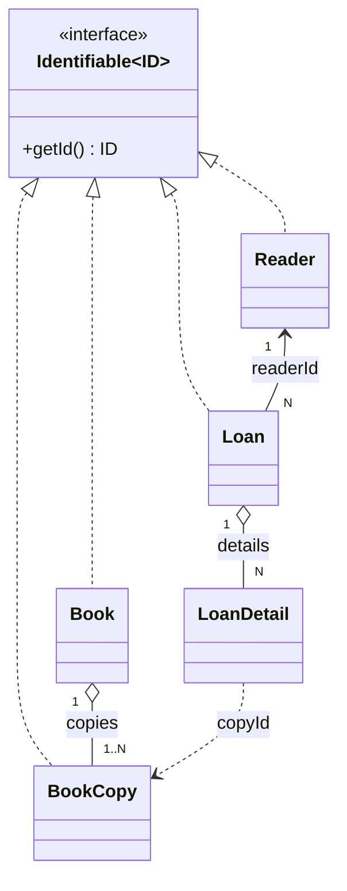

# du-an-cuoi-mon
# Thư viện mượn – trả

Đồ án nhóm MOB1024 – Đề tài 2. Nhóm 4 người, 18 buổi, cơ sở dữ liệu `library_loan` (SQL Server).

> File này gom phần đặc tả các lớp và bảng phân công để cả nhóm tra cứu. Những mục ghi **[Cần chốt]** là chỗ nhóm chưa thống nhất hoặc chưa có trong đặc tả đang có, cần bổ sung từ đặc tả gốc (`docs/01-dac-ta.md`).

## 1. Cấu trúc project

```
src/library/
├── Main.java
├── enums/         CopyStatus, ReaderType, LoanStatus, ReturnCondition
├── exception/     4 exception dùng chung
├── model/         Identifiable, Book, BookCopy, Reader, Loan, LoanDetail
├── repository/    interface + bản file + bản JDBC
├── service/       BookService, LoanService, ReportService, MigrationService...
├── ui/            ConsoleUI
└── util/          Input, DBConnect, SqlFilter
data/              file .dat (không commit)
sql/               01_schema.sql, 02_sample_data.sql
docs/              đặc tả, class diagram, biên bản
```

Package gốc là `library`, nên dòng đầu mỗi file có dạng `package library.model;`.

## 2. Quan hệ giữa các lớp



- Đầu sách có nhiều bản sao (1–N), lưu cùng đối tượng cha.
- Phiếu mượn có nhiều dòng chi tiết (1–N), lưu cùng đối tượng cha.
- Các lớp tham chiếu nhau bằng **mã** (`bookId`, `readerId`, `copyId`), không giữ đối tượng của lớp khác.

## 3. Quy ước chung cho các lớp

- Entity cài đặt `Serializable` để ghi file bằng `ObjectOutputStream`.
- Entity có mã cài đặt `Identifiable<String>` (`Book`, `BookCopy`, `Reader`, `Loan`).
- Constructor gọi các setter để **dùng chung phần kiểm tra dữ liệu**.
- Setter có kiểm tra: dữ liệu sai thì ném `IllegalArgumentException` kèm thông báo rõ ràng.
- Thuộc tính ghi `final` chỉ gán một lần trong constructor.
- Thuộc tính ghi "không có setter" chỉ đổi qua phương thức nghiệp vụ của lớp.
- Danh sách con (`copies`, `details`) khởi tạo rỗng, thêm qua phương thức của lớp.

## 4. Đặc tả các lớp

### 4.1. `Book` – Đầu sách

Cài đặt: `Identifiable<String>`, `Serializable`.

| Thuộc tính | Kiểu | Ý nghĩa | Kiểm tra / ghi chú |
|---|---|---|---|
| `id` | `String` | Mã đầu sách | Phải có dạng `S001` |
| `title` | `String` | Tên sách | Không được rỗng |
| `author` | `String` | Tác giả | Không được rỗng |
| `category` | `String` | Thể loại | Không được rỗng |
| `publishYear` | `int` | Năm xuất bản | Từ 1900 đến năm hiện tại |
| `price` | `double` | Giá sách (dùng tính phạt) | Phải lớn hơn 0 |
| `copies` | `List<BookCopy>` | Danh sách bản sao (1–N) | Khởi tạo rỗng, thêm qua phương thức của lớp |

| Phương thức | Mô tả |
|---|---|
| `Book(String id, String title, String author, String category, int publishYear, double price)` | Constructor đầy đủ tham số, gọi setter để dùng chung phần kiểm tra |
| `getId() : String` | Trả mã (cài đặt `Identifiable`) |
| `get…()` / `is…()` | Getter cho mọi thuộc tính |
| `set…(…)` | Setter có kiểm tra (sai thì ném `IllegalArgumentException`): `setId`, `setTitle`, `setAuthor`, `setCategory`, `setPublishYear`, `setPrice` |
| `nextCopyId() : String` | Mã bản sao kế tiếp: `S001-01`, `S001-02`... |
| `availableCount() : long` | Số bản sao đang ở trạng thái Sẵn sàng |
| `toString() : String` | Chuỗi một dòng để in danh sách |

### 4.2. `BookCopy` – Bản sao sách

Bản sao vật lý của một đầu sách. Cài đặt: `Serializable`; có `getId()` theo `Identifiable`.

| Thuộc tính | Kiểu | Ý nghĩa | Kiểm tra / ghi chú |
|---|---|---|---|
| `id` | `String` | Mã bản sao | `final`, gán một lần trong constructor |
| `bookId` | `String` | Mã đầu sách | `final`, gán một lần trong constructor |
| `status` | `CopyStatus` | Trạng thái | Không được thiếu trạng thái |

| Phương thức | Mô tả |
|---|---|
| `BookCopy(String id, String bookId, CopyStatus status)` | Constructor; mã bản sao phải có dạng `S001-01` |
| `getId() : String` | Trả mã (cài đặt `Identifiable`) |
| `get…()` / `is…()` | Getter cho mọi thuộc tính |
| `setStatus(CopyStatus)` | Setter có kiểm tra (sai thì ném `IllegalArgumentException`) |
| `toString() : String` | Chuỗi một dòng để in danh sách |

### 4.3. `Reader` – Độc giả

Cài đặt: `Identifiable<String>`, `Serializable`.

| Thuộc tính | Kiểu | Ý nghĩa | Kiểm tra / ghi chú |
|---|---|---|---|
| `id` | `String` | Mã độc giả | Phải có dạng `DG001` |
| `name` | `String` | Tên | Không được rỗng |
| `phone` | `String` | Số điện thoại | 10 số, bắt đầu bằng 0 |
| `type` | `ReaderType` | Loại độc giả | Phải chọn loại độc giả |
| `active` | `boolean` | Thẻ còn hiệu lực | — |

| Phương thức | Mô tả |
|---|---|
| `Reader(String id, String name, String phone, ReaderType type, boolean active)` | Constructor đầy đủ tham số, gọi setter để dùng chung phần kiểm tra |
| `getId() : String` | Trả mã (cài đặt `Identifiable`) |
| `get…()` / `is…()` | Getter cho mọi thuộc tính |
| `set…(…)` | Setter có kiểm tra (sai thì ném `IllegalArgumentException`): `setId`, `setName`, `setPhone`, `setType`, `setActive` |
| `setPhone(String phone)` | **Không bắt buộc**: để trống thì bỏ qua, có nhập thì phải đúng 10 số bắt đầu bằng 0 |
| `toString() : String` | Chuỗi một dòng để in danh sách |

### 4.4. `Loan` – Phiếu mượn

Phiếu mượn – thực thể gốc chứa `List` chi tiết. Cài đặt: `Identifiable<String>`, `Serializable`.

| Thuộc tính | Kiểu | Ý nghĩa | Kiểm tra / ghi chú |
|---|---|---|---|
| `id` | `String` | Mã phiếu mượn | Không có setter; chỉ đổi qua phương thức nghiệp vụ của lớp |
| `readerId` | `String` | Mã độc giả | Không có setter; chỉ đổi qua phương thức nghiệp vụ của lớp |
| `borrowDate` | `LocalDate` | Ngày mượn | Không có setter; chỉ đổi qua phương thức nghiệp vụ của lớp |
| `dueDate` | `LocalDate` | Hạn trả | Hạn trả phải hợp lệ (sau ngày mượn) |
| `extended` | `boolean` | Đã gia hạn chưa | Chỉ được gia hạn 1 lần |
| `status` | `LoanStatus` | Trạng thái | Không được thiếu trạng thái phiếu |
| `details` | `List<LoanDetail>` | Danh sách dòng chi tiết (1–N, lưu cùng đối tượng cha) | Khởi tạo rỗng, thêm qua phương thức của lớp |

| Phương thức | Mô tả |
|---|---|
| `Loan(String id, String readerId, LocalDate borrowDate, LocalDate dueDate, boolean extended, LoanStatus status)` | Constructor; kiểm tra: mã phiếu không rỗng; phải có độc giả; hạn trả phải sau ngày mượn |
| `getId() : String` | Trả mã (cài đặt `Identifiable`) |
| `get…()` / `is…()` | Getter cho mọi thuộc tính |
| `set…(…)` | Setter có kiểm tra (sai thì ném `IllegalArgumentException`): `setDueDate`, `setExtended`, `setStatus` |
| `notReturnedCount() : long` | Số cuốn chưa trả trong phiếu |
| `totalFine() : double` | Tổng tiền phạt của phiếu |
| `detail(String copyId) : LoanDetail` | Tìm dòng chi tiết theo mã bản sao (`null` nếu không có) |

### 4.5. `LoanDetail` – Dòng phiếu mượn

Một bản sao trong phiếu mượn. `returnDate = null` nghĩa là chưa trả. Cài đặt: `Serializable`.

| Thuộc tính | Kiểu | Ý nghĩa | Kiểm tra / ghi chú |
|---|---|---|---|
| `copyId` | `String` | Mã bản sao | `final`, gán một lần trong constructor |
| `returnDate` | `LocalDate` | Ngày trả (`null` = chưa trả) | Không có setter; chỉ đổi qua phương thức nghiệp vụ của lớp |
| `condition` | `ReturnCondition` | Tình trạng khi trả | Không có setter; chỉ đổi qua phương thức nghiệp vụ của lớp |
| `fine` | `double` | Tiền phạt của cuốn này | Không có setter; chỉ đổi qua phương thức nghiệp vụ của lớp |

| Phương thức | Mô tả |
|---|---|
| `LoanDetail(String copyId, LocalDate returnDate, ReturnCondition condition, double fine)` | Constructor; kiểm tra: thiếu mã bản sao; tiền phạt không âm |
| `get…()` / `is…()` | Getter cho mọi thuộc tính |
| `markReturned(LocalDate date, ReturnCondition condition, double fine)` | Ghi nhận trả sách |

## 5. Enum

Đặc tả đang có chưa liệt kê giá trị của enum. Bảng dưới là **đề xuất tạm**, nhóm chốt ở buổi họp đầu. Tên hằng số phải ổn định vì mọi người viết code dựa vào đó; nhãn tiếng Việt sửa sau được.

| Enum | Dùng ở | Giá trị đề xuất | Ghi chú |
|---|---|---|---|
| `CopyStatus` | `BookCopy.status` | `AVAILABLE`, `BORROWED`, `DAMAGED`, `LOST` | **[Cần chốt]** Nhãn "Sẵn sàng" hay "Có sẵn"; "Hỏng" hay "Hư hỏng". `Book.availableCount()` đếm trạng thái Sẵn sàng |
| `ReaderType` | `Reader.type` | `STUDENT`, `TEACHER` | Có `maxBooks` và `loanDays` (làm ở Bước 2) |
| `LoanStatus` | `Loan.status` | `BORROWING`, `RETURNED`, `OVERDUE` | **[Cần chốt]** Do C viết hay B viết |
| `ReturnCondition` | `LoanDetail.condition` | `GOOD`, `DAMAGED`, `LOST` | **[Cần chốt]** Do D viết hay B viết |

## 6. Quy tắc mã

| Đối tượng | Dạng mã | Ví dụ |
|---|---|---|
| Đầu sách | `S` + 3 chữ số | `S001` |
| Bản sao | mã đầu sách + `-` + 2 chữ số | `S001-01` |
| Độc giả | `DG` + 3 chữ số | `DG001` |
| Phiếu mượn | `PM` + ngày + `-` + số thứ tự | `PM20261025-001` |

## 7. Chức năng và người phụ trách

Tên các thành viên: **[Cần điền]** A: ……… · B: ……… · C: ……… · D: ………

| Mã | Chức năng | Phụ trách |
|---|---|---|
| FR-01 | Thêm / sửa / xóa / xem đầu sách | A |
| FR-02 | Thêm nhiều bản sao, xem, đổi trạng thái | A |
| FR-03 | Thêm / sửa / xem độc giả, khóa / mở khóa | B |
| FR-04 | Mượn sách: một phiếu nhiều bản sao | C |
| FR-05 | Trả sách, tính phạt, in biên lai | D |
| FR-06 | Gia hạn phiếu | C |
| FR-07 | Tự đánh dấu phiếu quá hạn khi khởi động | C |
| FR-08 | Tìm sách, sắp xếp, phân trang | A |
| FR-09 | Tra cứu phiếu mượn, phân trang | C |
| FR-10 | Thống kê (D chủ trì `ReportService`) | D; TK-01, TK-05 do A; TK-06, TK-07 do C; TK-02, TK-03, TK-04 do D |
| FR-11 | Xuất danh sách quá hạn ra HTML / CSV | D |
| FR-12 | Lưu dữ liệu, mở lại còn nguyên | B |
| FR-13 | Chọn nguồn dữ liệu File / SQL Server | B |
| FR-14 | Chuyển dữ liệu từ file vào CSDL | B |

Kịch bản nghiệm thu: A phụ trách TC-09, TC-10. B phụ trách TC-11, TC-12. C phụ trách TC-01, TC-02, TC-03, TC-07, TC-08. D phụ trách TC-04, TC-05, TC-06.

## 8. Vai trò và file sở hữu

| Thành viên | Vai trò | Nhận trọn gói |
|---|---|---|
| A | Sách, bản sao, tìm kiếm | `Book`, `BookCopy`, phần sách của `BookService`, `BookCriteria`, `BookView`, `BookSort`, `Page`, `FileBookRepository`, `JdbcBookRepository` |
| B | Độc giả và hạ tầng dùng chung (điều phối kỹ thuật) | `Identifiable`, 4 enum, 4 exception, `GenericRepository` và các interface repository, `Input`, `Reader`, `ReaderType`, `FileRepository`, `DBConnect`, `JdbcRepository`, `SqlFilter`, script SQL và dữ liệu mẫu, `Main`, `SampleData`, `MigrationService` |
| C | Mượn sách, gia hạn, quá hạn | `Loan`, `LoanStatus`, `LoanService` (borrow, extend, markOverdue, borrowingCount), `FileLoanRepository` và `JdbcLoanRepository` (create, markOverdue, search, nextId), `LoanCriteria`, `LoanSummary` |
| D | Trả sách, tiền phạt, báo cáo, giao diện | `LoanDetail`, `ReturnCondition`, `FinePolicy`, `ReturnLine`, `returnBooks` và biên lai, `returnCopy` ở hai repository, `ReportService`, `ConsoleUI`, `@Author` |

Mỗi người sở hữu file của mình. Muốn sửa file của người khác thì tạo pull request và nhờ chủ file duyệt.

File có hai người cùng sửa: `BookService` (A phần sách, B phần độc giả), `LoanService` (C phần mượn, D phần trả), `FileLoanRepository` và `JdbcLoanRepository` (C và D). Mỗi người chỉ sửa phương thức của mình, pull trước khi push.

## 9. Lộ trình theo buổi

| Bước | Buổi | Nội dung | Bàn giao |
|---|---|---|---|
| 1 | 1–2 | OOP | Đặc tả, class diagram, package `model` biên dịch được |
| 2 | 3–4 | Enum, Collection, Map | CRUD sách, bản sao, độc giả trên bộ nhớ |
| 3 | 5–6 | Lambda, Stream | Tìm sách có phân trang, ít nhất 5 thống kê |
| 4 | 7–8 | Exception, Generics | Mượn, trả, gia hạn chạy trên bộ nhớ |
| 5 | 9–10 | I/O (Mốc 1) | Lưu và mở lại bằng file, demo giai đoạn 1 |
| 6 | 11–12 | JDBC | Chế độ SQL Server tìm sách, tra cứu phiếu |
| 7 | 13–14 | JDBC nâng cao | Mọi nghiệp vụ chạy trên SQL Server, demo rollback |
| 8 | 15 | Record, Annotation, Text Block | Biên lai và báo cáo dùng Text Block |
| 9 | 16–18 | Tích hợp, kiểm thử chéo, bảo vệ | Chạy TC-01 đến TC-12, hoàn thiện tài liệu |

Mốc 1 (cuối Bước 5) là mốc demo giai đoạn 1: không bắt đầu Bước 6 khi phần bộ nhớ và phần file chưa chạy đúng.

## 10. Quy ước làm việc

- **Git**: mỗi tính năng một nhánh riêng, mở pull request, có ít nhất một người khác xem lại trước khi gộp. Commit nhỏ, thông điệp rõ.
- **Không commit**: `data/*.dat`, `db.properties` (có mật khẩu). Mỗi người chép `db.properties.example` thành `db.properties` và tự điền mật khẩu trên máy mình.
- Họp 10–15 phút đầu mỗi buổi: ai đã xong gì, ai đang bị chặn bởi ai.
- Đặt tên theo `Quy-tac-dat-ten.md`; mỗi thành viên commit phần mình làm (NFR-07).

## 11. Phụ thuộc và rủi ro

- Interface repository của B là điểm nghẽn: B phải đưa lên đầu Bước 4, và cả nhóm nên thống nhất chữ ký phương thức từ Bước 2.
- `Loan` (C) và `LoanDetail` (D) gắn chặt với nhau: C và D chốt chữ ký phương thức của hai lớp này ngay buổi 2.
- Enum và nhãn tiếng Việt phải thống nhất ngay từ đầu, nếu không menu và biên lai sẽ hiện không đồng nhất.
- Việc của C và D là nặng nhất; nếu một trong hai bị trễ thì B hoặc A nhận hỗ trợ.

## 12. Còn thiếu so với đặc tả gốc

Bổ sung vào mục này khi chép từ `docs/01-dac-ta.md`:

- [ ] Quy tắc nghiệp vụ BR-01 đến BR-09 (giới hạn số sách mượn, thời hạn mượn, gia hạn, tiền phạt...).
- [ ] Danh sách 4 exception và thời điểm ném.
- [ ] Kịch bản nghiệm thu TC-01 đến TC-12 và mô tả thống kê TK-01 đến TK-07.
- [ ] Thiết kế bảng CSDL `library_loan` (ERD) ở Bước 6.
