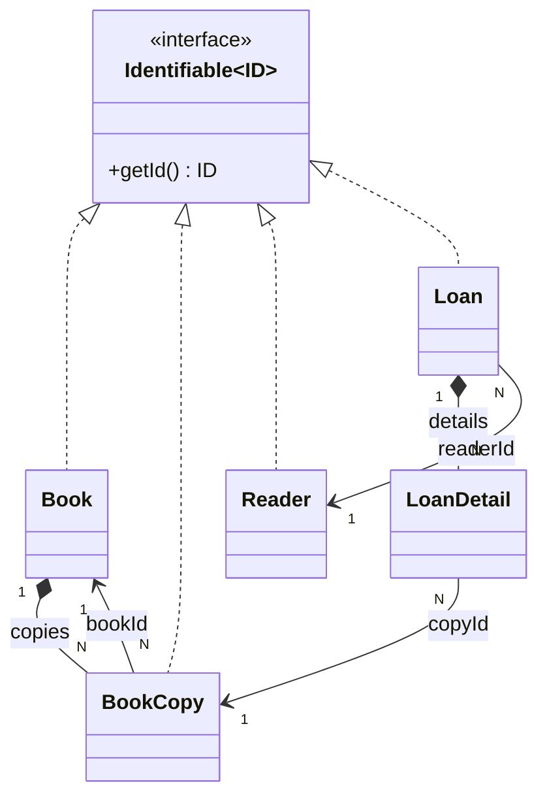

# Thư viện mượn – trả

Đồ án nhóm MOB1024 – Đề tài 2. Nhóm 4 người, 18 buổi, cơ sở dữ liệu `library_loan` (SQL Server).

Phần mềm console cho thư viện trường: quản lý đầu sách và từng bản sao, độc giả (sinh viên, giảng viên), lập phiếu mượn nhiều cuốn, trả từng cuốn hoặc cả phiếu, tự tính tiền phạt trễ hạn / hỏng / mất, tự đánh dấu phiếu quá hạn. Giai đoạn 1 lưu file, giai đoạn 2 lưu SQL Server.

> **Đặc tả đầy đủ** (chức năng, quy tắc nghiệp vụ, thiết kế từng lớp, kịch bản nghiệm thu, các bước theo slide) nằm ở [`docs/01-dac-ta.md`](docs/01-dac-ta.md). README này chỉ là bản tra cứu nhanh.

Tên thành viên: **A: Thái  ·  B: Hiếu  ·  C: M.Long  ·  D: T.Long**

## 1. Cấu trúc project

Theo sơ đồ mục 9.1 của đặc tả, thay gói gốc `app` bằng `library`:

```
src/library/
├── Main.java
├── model/        Book, BookCopy, Reader, Loan, LoanDetail, Identifiable, Page, Criteria,
│                 CopyStatus, LoanStatus, ReaderType, ReturnCondition
├── exception/    BusinessException, DataAccessException, DuplicateIdException, NotFoundException
├── repository/   GenericRepository, Repositories (các interface)
│   ├── file/     FileRepository, FileReaderRepository, FileBookRepository, FileLoanRepository
│   └── jdbc/     DBConnect, JdbcRepository, SqlFilter, JdbcReaderRepository, ...
├── service/      BookService, LoanService, ReportService, MigrationService, SampleData
├── ui/           ConsoleUI, Input
└── annotation/   Author
data/             file .dat (không commit)
sql/              01_schema.sql, 02_sample_data.sql
docs/             đặc tả, class diagram, biên bản, AI_LOG.md
```

Đặc tả cho phép đổi tên, gộp hoặc tách lớp, nhưng phải giữ đủ trách nhiệm và giữ cách chia tầng: `ui → service → repository (interface) ← repository.file / repository.jdbc`. Service và UI không chứa SQL, không đọc ghi file.

## 2. Quan hệ giữa các thực thể



- `Book ◆ BookCopy` và `Loan ◆ LoanDetail`: dòng con không tồn tại độc lập, lưu cùng đối tượng cha.
- Các quan hệ còn lại tham chiếu bằng **mã** (như khóa ngoại), không giữ đối tượng của lớp khác.

## 3. Các lớp thực thể (tóm tắt)

Chi tiết từng thuộc tính, phương thức và thông báo lỗi: `docs/01-dac-ta.md`, mục 9.2.

| Lớp | Mã dạng | Thuộc tính chính | Ràng buộc nổi bật |
|---|---|---|---|
| `Book` | `S001` | `title`, `author`, `category`, `publishYear`, `price`, `copies` | Chuỗi không rỗng; năm từ 1900 đến năm hiện tại; giá > 0. Có `nextCopyId()`, `availableCount()` |
| `BookCopy` | `S001-01` | `id`, `bookId` (`final`), `status` | Mã đúng dạng; trạng thái không được thiếu |
| `Reader` | `DG001` | `name`, `phone`, `type`, `active` | Tên không rỗng; SĐT không bắt buộc, có thì phải 10 số bắt đầu bằng 0; phải chọn loại |
| `Loan` | `PM20261025-001` | `readerId`, `borrowDate`, `dueDate`, `extended`, `status`, `details` | Hạn trả phải sau ngày mượn; id, readerId, borrowDate không có setter. Có `notReturnedCount()`, `totalFine()`, `detail(copyId)` |
| `LoanDetail` | — | `copyId` (`final`), `returnDate` (null = chưa trả), `condition`, `fine` | Có mã bản sao; phạt không âm. Đổi qua `markReturned(...)` |

Quy ước chung:

- Thuộc tính luôn `private`; mọi lớp thực thể có getter.
- Constructor có tham số **gọi lại setter** để dùng chung phần kiểm tra.
- Sai dữ liệu thì setter ném `IllegalArgumentException` kèm thông báo tiếng Việt.
- Thực thể cài `Identifiable<ID>` (`getId()`) và `Serializable` (ghi file bằng Object Stream).
- Enum có nhãn tiếng Việt, `getLabel()` và `toString()` trả về nhãn.

## 4. Enum

| Enum | Hằng (nhãn) | Ghi chú |
|---|---|---|
| `CopyStatus` | `AVAILABLE` ("Sẵn sàng"), `BORROWED` ("Đang mượn"), `DAMAGED` ("Hư hỏng"), `LOST` ("Mất") | `Book.availableCount()` đếm `AVAILABLE` |
| `LoanStatus` | `BORROWING` ("Đang mượn"), `OVERDUE` ("Quá hạn"), `RETURNED` ("Đã trả") | |
| `ReaderType` | `STUDENT` ("Sinh viên", 3, 14), `LECTURER` ("Giảng viên", 5, 30) | Tham số: `maxBooks`, `loanDays`. Service đọc từ enum, **không** viết số 3, 5, 14, 30 trong service |
| `ReturnCondition` | `NORMAL` ("Bình thường"), `DAMAGED` ("Hư hỏng"), `LOST` ("Mất") | |

## 5. Quy tắc mã

| Đối tượng | Dạng mã | Ví dụ |
|---|---|---|
| Đầu sách | `S` + 3 chữ số | `S001` |
| Bản sao | mã đầu sách + `-` + 2 chữ số | `S001-01` |
| Độc giả | `DG` + 3 chữ số | `DG001` |
| Phiếu mượn | `PM` + ngày `yyyyMMdd` + `-` + số thứ tự | `PM20261025-001` |

## 6. Quy tắc nghiệp vụ

| Mã | Quy tắc | Khi vi phạm | Áp dụng |
|---|---|---|---|
| BR-01 | Số cuốn đang mượn + mượn mới ≤ giới hạn loại độc giả (SV 3, GV 5) | `BusinessException` | FR-04 |
| BR-02 | Độc giả có phiếu quá hạn không được mượn mới | `BusinessException` | FR-04 |
| BR-03 | Độc giả bị khóa không được mượn | `BusinessException` | FR-04 |
| BR-04 | Chỉ mượn được bản sao "Sẵn sàng" | `BusinessException` | FR-04 |
| BR-05 | Chỉ gia hạn 1 lần (+7 ngày), khi phiếu chưa quá hạn | `BusinessException` | FR-06 |
| BR-06 | Phạt mỗi cuốn = 5.000đ × số ngày trễ (không âm) + 30% giá sách nếu hỏng, hoặc + 100% giá sách nếu mất | — | FR-05 |
| BR-07 | Hạn trả = ngày mượn + số ngày mượn của loại độc giả; phải sau ngày mượn | — | FR-04 |
| BR-08 | Mã đầu sách, bản sao, độc giả là duy nhất; năm xuất bản 1900 – năm hiện tại; giá > 0 | `DuplicateIdException` / báo lỗi nhập | FR-01..03 |
| BR-09 | Không xóa đầu sách đang có bản sao được mượn | `BusinessException` | FR-01 |

Ví dụ tính phạt: sách 120.000đ, trả trễ 4 ngày, bình thường → 20.000đ; trễ 4 ngày và hỏng → 20.000 + 36.000 = 56.000đ; mất, không trễ → 120.000đ.

## 7. Chức năng và người phụ trách

| Mã | Chức năng | Phụ trách |
|---|---|---|
| FR-01 | Thêm / sửa / xóa / xem đầu sách | A |
| FR-02 | Thêm nhiều bản sao một lần; xem, đổi trạng thái bản sao | A |
| FR-03 | Thêm / sửa / xem độc giả; khóa / mở khóa | B |
| FR-04 | Mượn sách: một phiếu nhiều bản sao | C |
| FR-05 | Trả sách: từng cuốn hoặc cả phiếu, ghi tình trạng, tính phạt, in biên lai | D |
| FR-06 | Gia hạn phiếu (một lần, +7 ngày) | C |
| FR-07 | Tự đánh dấu phiếu quá hạn mỗi khi khởi động | C |
| FR-08 | Tìm sách nhiều tiêu chí + sắp xếp + phân trang, hiện số bản còn rảnh | A |
| FR-09 | Tra cứu phiếu mượn + phân trang | C |
| FR-10 | Thống kê (ít nhất 5 trong 7): TK-01, TK-05 do A; TK-06, TK-07 do C; TK-02, TK-03, TK-04 do D | D chủ trì |
| FR-11 | Xuất danh sách quá hạn ra HTML hoặc CSV | D |
| FR-12 | Lưu toàn bộ dữ liệu, mở lại còn nguyên | B |
| FR-13 | Chọn nguồn dữ liệu File / SQL Server khi khởi động | B |
| FR-14 | Chuyển dữ liệu từ file vào CSDL (bỏ qua mã trùng) | B |

Nghiệm thu: A phụ trách TC-09, TC-10. B phụ trách TC-11, TC-12. C phụ trách TC-01, 02, 03, 07, 08. D phụ trách TC-04, 05, 06.

## 8. Tầng repository và service (tóm tắt)

**`GenericRepository<T, ID>`**: `findAll()`, `findById(id) : Optional<T>`, `existsById(id)`, `insert(entity)`, `update(entity) : boolean`, `deleteById(id) : boolean`.

| Interface | Phương thức thêm |
|---|---|
| `ReaderRepository` | Chỉ dùng CRUD chung |
| `BookRepository` | `search(BookCriteria, page, size) : Page<BookView>`, `addCopies(bookId, n) : List<String>`, `findCopy(copyId)`, `findAllCopies()` |
| `LoanRepository` | `create(Loan)`, `returnCopy(loanId, copyId, date, cond, fine)`, `markOverdue(today) : int`, `search(LoanCriteria, page, size)`, `existsByReader`, `existsByBook`, `nextId(date)` |

Hai bản cài đặt: `FileRepository` (Bước 5, mỗi thực thể một file `.dat`, trong bộ nhớ là `Map<ID, T>`) và `JdbcRepository` (Bước 6–7, mọi câu SQL dùng `PreparedStatement`). Đổi File ↔ SQL Server không phải sửa service.

| Ngoại lệ | Kế thừa | Dùng khi |
|---|---|---|
| `BusinessException` | `Exception` | Vi phạm quy tắc nghiệp vụ |
| `DataAccessException` | `RuntimeException` | Bọc `IOException` / `SQLException` để service, ui không phụ thuộc `java.io` / `java.sql` |
| `DuplicateIdException(what, id)` | `Exception` | Trùng mã khi thêm mới |
| `NotFoundException(what, id)` | `Exception` | Không tìm thấy theo mã |

Service: `BookService` (sách, bản sao, độc giả), `LoanService` (mượn, trả, gia hạn, quá hạn, biên lai), `ReportService` (7 thống kê + xuất HTML/CSV), `MigrationService` (file → CSDL), `SampleData` (dữ liệu mẫu cho chế độ File).

## 9. Vai trò và file sở hữu

| Thành viên | Vai trò | Nhận trọn gói |
|---|---|---|
| A | Sách, bản sao, tìm kiếm | `Book`, `BookCopy`, phần sách của `BookService`, `BookCriteria`, `BookView`, `BookSort`, `Page`, `FileBookRepository`, `JdbcBookRepository` |
| B | Độc giả và hạ tầng dùng chung (điều phối kỹ thuật) | `Identifiable`, 4 enum, 4 exception, `GenericRepository` và các interface repository, `Input`, `Reader`, `ReaderType`, `FileRepository`, `DBConnect`, `JdbcRepository`, `SqlFilter`, script SQL và dữ liệu mẫu, `Main`, `SampleData`, `MigrationService` |
| C | Mượn sách, gia hạn, quá hạn | `Loan`, `LoanStatus`, `LoanService` (borrow, extend, markOverdue, borrowingCount), `FileLoanRepository` và `JdbcLoanRepository` (create, markOverdue, search, nextId), `LoanCriteria`, `LoanSummary` |
| D | Trả sách, tiền phạt, báo cáo, giao diện | `LoanDetail`, `ReturnCondition`, `FinePolicy`, `ReturnLine`, `returnBooks` và biên lai, `returnCopy` ở hai repository, `ReportService`, `ConsoleUI`, `@Author` |

Mỗi người sở hữu file của mình; muốn sửa file người khác thì mở pull request và nhờ chủ file duyệt. File hai người cùng sửa (`BookService`, `LoanService`, `FileLoanRepository`, `JdbcLoanRepository`): mỗi người chỉ sửa phương thức của mình, pull trước khi push.

## 10. Lộ trình

| Bước | Buổi | Slide | Nội dung | Bàn giao |
|---|---|---|---|---|
| 1 | 1–2 | OOP | Đặc tả, class diagram, package `model` | Model biên dịch được |
| 2 | 3–4 | Enum, Collection, Map | 4 enum, repository bộ nhớ, CRUD FR-01..03 | CRUD sách, bản sao, độc giả trên bộ nhớ |
| 3 | 5–6 | Lambda, Stream | Tìm sách có phân trang, ≥ 5 thống kê | TC-09 đạt trên bộ nhớ |
| 4 | 7–8 | Exception, Generics | 4 exception, `GenericRepository`, mượn / trả / gia hạn | Chạy trên bộ nhớ |
| 5 | 9–10 | I/O | `FileRepository`, xử lý file lỗi, FR-11 bản CSV | **Mốc 1**: demo giai đoạn 1 |
| 6 | 11–12 | JDBC | ERD, script SQL, `DBConnect`, phần đọc, FR-08 / FR-09 bằng JOIN | Chế độ SQL Server tìm sách, tra cứu phiếu |
| 7 | 13–14 | JDBC nâng cao | Transaction mượn / trả, batch, UPDATE có điều kiện | Mọi nghiệp vụ chạy trên SQL Server, demo rollback |
| 8 | 15 | Record, Annotation, Text Block | Record cho thống kê, biên lai và HTML bằng Text Block, `@Author` | |
| 9 | 16–18 | — | FR-14, kiểm thử chéo TC-01..12, hoàn thiện tài liệu | Bảo vệ |

Không bắt đầu Bước 6 khi phần bộ nhớ và phần file chưa chạy đúng.

## 11. Quy ước làm việc

- **Git**: mỗi tính năng một nhánh riêng, mở pull request, có ít nhất một người khác xem lại trước khi gộp. Commit nhỏ, thông điệp rõ; mỗi người commit phần mình làm (NFR-07).
- **Không commit**: `data/*.dat`, `db.properties` (có mật khẩu). Chép `db.properties.example` thành `db.properties` và tự điền mật khẩu trên máy mình. Repo đang **Public**, nên tuyệt đối không đẩy mật khẩu lên.
- Họp 10–15 phút đầu mỗi buổi: ai đã xong gì, ai đang bị chặn bởi ai.
- Mọi lỗi báo bằng tiếng Việt rồi quay lại menu, chương trình không bao giờ dừng vì lỗi (NFR-01).

## 12. Việc cần chốt

- [ ] Điền tên bốn thành viên A–D.
- [ ] Vị trí enum và `Input`: đặc tả để enum trong `model` và `Input` trong `ui`. Nhóm giữ theo đặc tả hay đặt riêng `enums` / `util`.
- [ ] Nhãn trạng thái bản sao: mục 9.3 ghi "Sẵn sàng", còn mục 2 và 3 (FR-02, BR-04) ghi "Có sẵn". Chọn một và dùng thống nhất.
- [ ] C và D chốt chữ ký phương thức của `Loan` và `LoanDetail` ngay buổi 2.
- [ ] B soạn nháp chữ ký các interface repository và gửi nhóm góp ý trước Bước 4.
- [ ] Bật bảo vệ nhánh `main` (cần quyền chủ repo).
